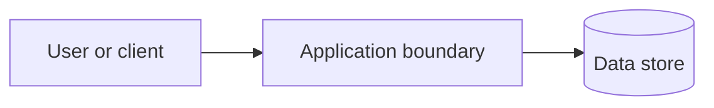

# ADR-<number>: <short decision title>

- **Status:** Proposed | Accepted | Rejected | Superseded
- **Date:** <YYYY-MM-DD>
- **Decision owners:** <people/team, if known>

## Context & Problem Statement

<Describe the system, the problem/decision in scope, relevant workflows, and why a decision is needed. Distinguish facts from assumptions.>

## Decision Drivers & Technical Constraints

- <Evidence-based requirement, quality attribute, or constraint>
- <Important assumption, labeled as an assumption>

## Options Considered

| Option | Summary | Advantages | Drawbacks / risks |
|---|---|---|---|
| <Option A> | <Deployment shape, components, data, communication> | <Specific benefits> | <Specific costs and risks> |
| <Option B> | <Deployment shape, components, data, communication> | <Specific benefits> | <Specific costs and risks> |

<For each viable option, explain feasibility and low-level implementation concerns in enough detail to support the comparison.>

## Decision Outcome & Rationale

<State the selected decision and why it best fits the drivers. If not confirmed, use Proposed status and label the recommendation as pending approval.>

## Consequences

### Positive

- <Benefits>

### Negative

- <Costs, limitations, and risks>

### Low-level implementation trade-offs and controls

- **<Concern>:** <Implementation approach, failure modes, mitigations, and any guarantee preconditions.>

## Architectural Guardrails

- <Module/service ownership and permitted communication>
- <Automated enforcement or review controls, where relevant>

## Visual Architectural Diagram

<Replace the illustrative diagram with one that accurately represents the decision, or omit if a diagram adds no clarity.>

## Assumptions, Open Questions, and Revisit Triggers

- <Unresolved question or assumption>
- <Evidence or change that should trigger reconsideration>
