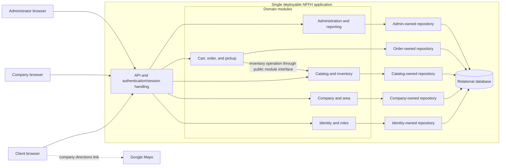

# ADR-001: Use a layered modular monolith for NFFH

- **Status:** Accepted
- **Date:** 2026-10-28
- **Decision owners:** NFFH project team

## Context & Problem Statement

Not Far(m) From Home (NFFH) connects clients with local agricultural companies. Companies register, publish and maintain produce listings, and manage their orders. Clients browse companies and products, build a cart, and reserve produce for pickup at a selected company on a chosen day. Administrators maintain users, areas, companies, and products, and inspect orders and users.

The system must distinguish client, company, and administrator permissions. A central correctness requirement is to avoid confirming more produce than is available when clients check out concurrently. The requirements do not specify expected traffic, team size, deployment environment, payment scope, or detailed pickup-capacity rules. They also do not decide whether an order may contain products from multiple companies.

We need an architecture that supports the end-to-end workflows, is feasible to implement and operate as an initial system, and can evolve if measured scale or organizational needs change.

## Decision Drivers & Technical Constraints

- Keep order creation and stock changes consistent under concurrent checkouts.
- Support role-specific operations for clients, agricultural companies, and administrators.
- Make the initial system straightforward to build, test, deploy, and operate when scale and team structure are unspecified.
- Preserve order history even when product prices or descriptions later change.
- Support persistent login sessions, explicit logout, product discovery, company locations, pickup selection, and administrative listings.
- Do not assume payment processing, delivery, refunds, or high-scale requirements that are absent from the source requirements.
- Keep domain boundaries explicit and enforceable so parts of the system can be extracted later if evidence justifies it.

## Options Considered

| Option | Summary | Main advantages | Main drawbacks |
|---|---|---|---|
| **Layered client-server monolith** | One application/API, separated into layers and domain modules, backed by a relational database. | Straightforward deployment and debugging; database transactions make order and stock invariants easier to enforce; low operational overhead. | Modules can become coupled without enforcement; independent scaling and releases are limited. |
| **Domain-oriented microservices** | Independently deployed services own identity, company/area, catalog/inventory, order, and admin/reporting domains and communicate through APIs/events. | Independent team ownership, scaling, and releases; failures can be isolated. | Distributed consistency, service operations, event handling, and cross-domain reporting add complexity not justified by current evidence. |
| **Serverless managed platform** | Managed authentication, API functions, relational database, and optional queue/event services. | Less server maintenance; automatic scaling and pay-per-use can suit variable workloads. | Provider coupling; function limits, database connection management, and asynchronous retries complicate implementation and debugging. |

## Decision Outcome & Rationale

Adopt a **layered modular monolith with a relational database** for NFFH. It is one deployable application, organized into domain modules with defined interfaces and a layered path from API/application logic through domain services to persistence.

The modules cover identity and roles, companies and areas, catalog and inventory, carts and orders, and administration. During checkout, the order workflow begins a database transaction, locks the relevant inventory rows using pessimistic row locking (`SELECT ... FOR UPDATE`), revalidates availability, and creates the order while decrementing stock. It commits all changes together or rolls them all back. Inventory rows should be locked in a stable order (such as ascending product ID) to reduce deadlocks. Every code path that changes stock must obey the same locking protocol; the database must support transactional row locks. Under those conditions, competing checkouts for the same stock serialize at the locked rows, preventing two transactions from selling the same available units.

Shopping carts are **mutable draft data persisted in the relational database**, separate from confirmed orders. A cart and its lines are associated with the client and can be reloaded across sessions/devices. A cart does not reserve stock: checkout revalidates current availability under the inventory locks. On successful checkout, create an order and immutable order-line snapshots (including price and relevant product description) in the transaction, then mark the cart checked out or clear its lines. A failed checkout must not create a partial order or decrement stock; the cart remains available for correction. Browser local storage or a cache may be used for non-authoritative UI convenience, but neither is the source of truth.

This option best fits the current evidence: expected scale and independent team ownership are unspecified, while stock-safe ordering is central. A single transactional boundary avoids distributed coordination before it is needed. The choice does not preclude later extraction; it requires clear module ownership and measurable reasons before adding distributed systems complexity.

## Consequences

### Positive

- A single deployment and primary database simplify initial development, testing, operations, and troubleshooting.
- Checkout can atomically create an order and update inventory using row locks, reducing the risk of overselling or partially persisted orders.
- Persisted carts survive reloads and separate mutable draft data from durable order history.
- Shared domain rules make it easier to apply consistent role checks and product/order behavior across client, farmer, and admin workflows.
- The architecture can begin without message brokers, service discovery, or distributed tracing.
- Clear, enforced domain modules preserve a practical path to later service extraction.

### Negative

- Application modules share a deployment lifecycle; independently releasing or scaling only one module is not straightforward.
- Without explicit boundaries and automated enforcement, direct dependencies and shared-table access can cause cross-module dependency bleeding and a tightly coupled monolith. Boundary rules and their CI checks add setup and maintenance overhead.
- Pessimistic row locks serialize checkout operations for overlapping inventory. A very popular product can become a contention hotspot; lock waits, deadlocks, and retries must be managed, and throughput for that product is bounded by the serialized critical section.
- A single application/database can become a scaling or availability bottleneck as usage grows; revisit the decision using operational evidence.
- The choice does not provide microservices-style fault isolation between domains.

### Architectural Guardrails

- Each domain module owns its domain behavior and persistence operations. Other modules must communicate only through that module's defined public application interfaces or explicitly defined in-process events; do not call its internal classes or repositories.
- Do not directly join or query another domain module's tables. A module accesses its own data through its repositories; cross-domain reads go through the owning module's public query interface or a deliberately maintained read model.
- The shared relational database is a deployment choice, not permission to share persistence internals. Keep schema/table ownership explicit, and do not let convenience queries bypass module APIs.
- Keep dependencies directed toward public contracts and avoid cyclic module dependencies. Shared code is limited to genuinely cross-cutting primitives; domain rules remain with their owning module.
- Enforce boundaries in CI with the strongest practical repository-native tools: package visibility (for example, package-private/internal access), import/dependency allowlists or forbidden-dependency rules, and architecture tests (for example, ArchUnit in Java). In a monorepo, use build-tool module boundaries and dependency validation. Select the concrete tool to match the implementation language; fail the build when a rule is violated.
- Require code review for changes to module contracts, ownership, or allowed dependency rules. Do not treat diagrams or conventions alone as enforcement.

### Low-level implementation trade-offs and controls

- **Concurrent stock updates:** Run checkout in one database transaction. Select all affected inventory rows with `SELECT ... FOR UPDATE`, in stable product-ID order, then revalidate requested quantities against the locked current values. If any line is unavailable, roll back without creating the order or decrementing stock. Otherwise decrement all quantities, write the order and order-line snapshots, and commit. Use a unique checkout/idempotency key to make safe retries possible. Configure bounded lock waits and retry only recognized deadlock/serialization failures with limits. Add database constraints (such as nonnegative quantity) as a final integrity guard. All stock writers, including farmer inventory edits and administrative operations, must follow compatible locking/transaction rules. Row locking prevents overselling only when the chosen database provides transactional row locks and every stock-changing path participates in this protocol; test this against the production database engine.
- **Cart lifecycle:** Persist cart headers/lines keyed to the client in the relational database. Keep cart rows mutable and order/order-line records durable and immutable with respect to the original purchase facts. Define whether a client has one active cart per company or one cart total; validate the chosen company boundary at checkout. Do not reserve stock merely by adding an item to a cart. Revalidate at checkout, and make successful cart conversion atomic with order creation.
- **Order history and deletion:** Store price and product-description snapshots on order lines so later catalog changes do not alter historical purchases. Avoid hard deletion of products or companies referenced by orders; define archival or deactivation behavior.
- **Module enforcement:** Encode the guardrails above in build/CI checks—package visibility, dependency allowlists, and architecture tests such as ArchUnit where applicable. Restrict repository access to owning modules and reject cross-module table joins in review and automated checks where feasible. Keep tests that deliberately verify permitted and forbidden module dependencies.
- **Pickup scheduling:** Validate that the selected date is offered by the company. Pickup capacity, cut-off times, and reservation expiry are not specified and require product decisions before implementing those policies.
- **Authorization and sessions:** Enforce role checks at every protected API operation, not only in the UI. Use secure, HTTP-only cookies for persistent web sessions, with expiry and server-side invalidation on logout.
- **Administrative queries:** Add indexes and pagination for user, order, area, company, and product listings. Keep administrative privileges narrow and audit sensitive maintenance operations where required.
- **External maps:** Store a normalized company location and construct a Google Maps directions link; map navigation is an external handoff, not part of order consistency.
- **Data integrity:** Use foreign keys and appropriate uniqueness/check constraints in addition to application validation. Define behavior for deleting areas or products that have historical references.

## Visual Architectural Diagram

The diagram shows logical boundaries, not a requirement for a separate interface service. The internal contracts are code-level module APIs/events. Each module accesses its own persistence through owned repositories; checkout may coordinate the order and inventory write within the monolith's single transaction while respecting the modules' contracts.

## Assumptions and Follow-up Questions

- Are carts and orders limited to one agricultural company, or may checkout split products across multiple pickup locations?
- When does stock become unavailable to other clients: at checkout, after confirmation, or only after farmer acceptance? Can a reservation expire?
- Which pickup dates and capacities can each company offer, and what are the booking cut-off rules?
- Is payment in scope, or is an order only a reservation for later pickup/payment?
- What scale, availability, privacy/retention, and deployment constraints should guide later architecture reviews?
- Which relational database and implementation language will be used? Confirm row-locking semantics and select appropriate dependency-boundary tooling for that stack.

Revisit this decision if measured traffic or availability requirements exceed the monolith's capabilities, if teams need independent deployments, or if managed serverless services materially reduce operational burden without weakening transactional stock guarantees.
