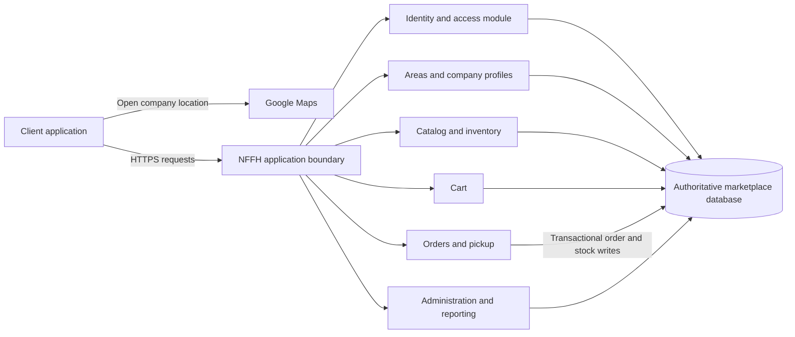

# ADR-002: Architecture for Not Far(m) From Home

- **Status:** Proposed
- **Date:** 2026-10-28
- **Decision owners:** Not specified

## Context & Problem Statement

Not Far(m) From Home (NFFH) is a platform intended to connect local agricultural companies (farmers/sellers) directly with consumers for local produce pickup. The requirements describe three actor types:

- **Clients** register, log in, retain a logged-in session across reloads, log out, view their own details, discover seasonal or “hot” products, browse companies in an area and their products, maintain a cart, place orders with a pickup day, open company locations in Google Maps, and review their orders.
- **Agricultural companies** register, log in, retain a logged-in session across reloads, log out, view their own details, manage product inventory and quantities, and review their orders.
- **Administrators** log in and retain a logged-in session across reloads, log out, manage users and areas, inspect companies by area and company details, inspect products by seller or ID, and add, modify, or delete areas and products. They can inspect all users and orders and obtain user details.

The explicit system purpose is local/direct interaction (“km 0”). The stated order workflow is reservation for pickup at the agricultural company, with a client selecting a day. There is no stated payment, delivery, messaging, or notification workflow; this decision does not add one. Google Maps is the only named external integration.

The architecture decision is how to divide application responsibilities, deploy them, own and persist marketplace data, and enforce the critical order/inventory and role boundaries. The system needs a coherent way to support browsing and three distinct operational views without letting client, farmer, or administrator access leak across those boundaries.

The requirements do **not** state expected traffic, availability, latency, team size, deployment platform, budget, regulatory obligations, geographic scope, or recovery objectives. Consequently, no option can be justified by an assumed scale or service-level target. This ADR compares three viable shapes and recommends a conservative starting point subject to the open questions below.

## Decision Drivers & Technical Constraints

### Evidence-based drivers

1. **Correct ordering and inventory:** clients add/remove products and complete orders; farmers can change or remove stock. Competing checkouts and edits must not silently create negative stock or orders for unavailable products.
2. **Role- and ownership-aware access:** client, company, and administrator stories expose different data and actions. Users must see only their own personal information and orders; a company must manage its own inventory and orders, while administrator actions are broader.
3. **Support the whole stated workflow:** area/company/product discovery, cart, order with pickup day, customer and farmer order views, inventory management, admin maintenance, and the map hand-off must fit together.
4. **Consistency and understandable failure recovery:** a successful order should have a defined relationship to product quantities, and retries or partial failures should not create duplicate or contradictory orders.
5. **Feasibility without invented scale requirements:** the chosen starting design should not require operating a distributed platform unless measured needs justify it.
6. **Evolution and maintainability:** separate domain responsibilities enough to change product, identity, ordering, and administration behavior without prematurely imposing separate deployments.

### Technical constraints and limits of evidence

- The only explicit external service is Google Maps. No payment provider, shipping service, email/SMS service, or integration protocol is specified.
- The requirements name users, companies, areas, products, inventory quantities, carts, and orders, but prescribe no data store, API, client platform, or deployment model.
- No stated volume, throughput, uptime, or geographic distribution supports a particular scaling technology.
- No explicit requirement defines transaction/rollback behavior, inventory reservation expiry, cancellation, pickup-slot capacity, or whether checkout may include products from multiple companies.
- A persistent login across reloads is required, but the session duration, revocation behavior, and identity verification policy are unspecified.
- A shared relational database is a **proposal**, not a requirement. Transactional safeguards in the recommended option depend on the selected database supporting transactions and conditional/locked inventory updates and on every order/inventory write path using the same rules.

## Options Considered

| Option | Deployment and data ownership | Fit to decision drivers | Main cost / risk |
|---|---|---|---|
| **A. Modular monolith with one transactional database** | One deployable application with enforced logical modules; one authoritative database for marketplace state. | Strong starting fit for workflow coherence, order/inventory consistency, and modest operational burden. | Shared release and scaling unit; module boundaries need discipline. |
| **B. Independently deployed domain services** | Separate identity, catalog/inventory, order, and administration/reporting services; each service owns its data and communicates over APIs/events. | Strong deployment/team autonomy and independent scaling if independently changing or high-load domains are demonstrated. | Distributed consistency, more operations, and cross-service checkout/recovery complexity. |
| **C. Managed backend / BaaS with policy-protected data and functions** | Managed identity and data/API platform; client may read permitted data through platform APIs; privileged writes and transactional workflows run in backend functions. | Potentially rapid delivery and low infrastructure administration if platform features meet the integrity and access requirements. | Correctness and security depend heavily on platform transaction/policy capabilities and careful client-vs-server boundaries. |

### Option A — Modular monolith with one transactional database

**Shape and workflow.** Deploy one server-side application, with logical modules for identity/access, areas and company profiles, product catalog and inventory, cart, order/pickup, and administration/reporting. A web or other client calls the application API; the application owns the authoritative marketplace database. Modules communicate through in-process interfaces and participate in database transactions where appropriate. Client, farmer, and administrator screens use the same API with role checks and resource-ownership checks at the application boundary. The company address/location is returned to the client for a Google Maps link; Maps is not part of order persistence.

Browsing reads areas, companies, and products from the catalog module. Cart edits update the client’s cart. Checkout validates the client, product/company status, quantities, and pickup-day input, then records the order and applies the defined stock rule in a database transaction. Farmer inventory changes and company order views use the same application and authoritative inventory/order data. Administrator queries and maintenance operations pass through explicit administrator authorization.

**Advantages and trade-offs.**

- A single deployable artifact and authoritative data boundary make the stated end-to-end workflows straightforward to implement and explain.
- A database transaction can coordinate order records and inventory changes without a distributed commit protocol, if all relevant writes use the same database and transaction.
- Clear logical modules provide room to evolve without imposing service discovery, asynchronous messaging, or independent data stores now.
- One release and failure domain means an application defect or deployment can affect all workflows; independently scaling one module is not available without later extraction.
- The database can become a shared contention point. Its actual capacity cannot be assessed without traffic, query, and availability targets.

**Low-level implementation pain points and failure modes.**

- **Overselling / lost updates:** do not implement checkout as “read quantity, then write quantity” without concurrency control. Use a single transaction and a conditional decrement or equivalent row-locking strategy, checking that every requested line succeeds before committing the order. The guarantee depends on the database’s transaction semantics and every write path, including farmer/admin inventory edits, following compatible rules.
- **Atomicity and retries:** assign an order identifier/idempotency key before processing checkout; a retry after a client timeout must return the original result rather than creating a second order. Commit order state and stock changes together. If any line fails validation, roll back the whole checkout unless the product owner explicitly chooses partial fulfillment.
- **Cart/order boundaries:** enforce product-company ownership and quantity constraints in server-side validation, not just in the UI. Do not treat a cart total or product price sent by a client as authoritative. Re-read price and availability at checkout.
- **Pickup day:** validate a selected day against an explicitly defined policy. The requirements do not say what days are allowed or whether a company has capacity; do not imply a slot/capacity reservation until that rule is decided.
- **Authorization:** centralize authentication and policy checks, then test client ownership, company ownership, and admin-only paths. Hiding a button or endpoint is not authorization. Admin reporting must not accidentally expose credentials or unrestricted personal information.
- **Hot products:** isolate the list/ranking behind a catalog query/service boundary. The requirements do not define its source or ranking, so make its policy replaceable rather than hard-coding an assumed sales algorithm.
- **Operational failure:** a single application release can break all actor workflows; use health checks, database backups/recovery procedures, and rollback-capable deployment practices appropriate to the eventual environment. These are operational needs to specify, not guarantees of the architecture itself.

**Feasibility.** This is feasible for a small team and is the simplest option to build and operate absent evidence for independent deployments or scale. It requires ordinary application/database skills and disciplined module/API boundaries. If separate teams, deployment isolation, or measured bottlenecks emerge, the logical modules offer extraction candidates; extraction would require defining service ownership and migrating data carefully.

### Option B — Independently deployed domain services

**Shape and workflow.** Deploy services with explicit ownership, for example: identity/access; catalog/company/area; inventory; orders/pickup; and administration/reporting. Each service owns its data and exposes APIs; services do not read or write another service’s database directly. A web client calls an API composition layer or suitable service APIs. Checkout is coordinated by the order service, which validates or reserves inventory through the inventory service and records the order in its own store. Events can propagate committed changes to read models used by browsing and administrator reporting. Authentication yields an identity/role context that each service validates and applies to its own resources. Google Maps remains a client hand-off using company location data.

**Advantages and trade-offs.**

- Services can be deployed and scaled independently where ownership, traffic, or change cadence actually differs.
- Data ownership makes service boundaries explicit and can reduce accidental cross-domain writes.
- A reporting/read model can serve administrator-wide queries without giving the admin interface unrestricted direct access to every service store.
- Independent deployment, service health, schema evolution, observability, and on-call responsibilities add material team and operational costs.
- A relational transaction cannot ordinarily span independent service databases. Checkout and reporting become eventually consistent or require a distributed workflow.

**Low-level implementation pain points and failure modes.**

- **Checkout saga:** if orders are written by one service and stock by another, a timeout can leave an order without a reservation or stock reserved without a visible order. Define a state machine (for example, pending, reserved, confirmed, failed), idempotent commands, durable event/outbox publication, bounded retries, and compensating release actions. A compensation is a new business action, not a rollback of the original distributed transaction.
- **Inventory races:** the inventory service must perform an atomic conditional reservation/decrement and return a durable reservation identifier. Repeated reserve/release requests must be idempotent. Define expiry and cancellation behavior before implementing reservations; neither is specified in the requirements.
- **Partial multi-company orders:** if one cart spans companies or inventory partitions, decide whether to create one parent order with per-company suborders, whether all sellers commit together, or whether partial success is allowed. Cross-service atomic all-or-nothing fulfillment is costly and should not be implied by an API.
- **Stale reads:** catalog, hot-product, and admin read models fed by events can lag. Label/handle stale availability at checkout by revalidating with inventory; do not use a browse result as proof that stock is still available.
- **Duplicate/lost events:** use an outbox or equivalent durable publication pattern, consumer deduplication, event versioning, and replay/reconciliation procedures. Otherwise outages or retries can duplicate order projections or leave admin views permanently incomplete.
- **Authorization propagation:** services must validate token issuer/audience/expiry and enforce resource ownership locally. Forwarded identity headers from an untrusted client or API gateway must not be trusted. Admin access across domains needs explicit, auditable contracts.
- **Reporting and deletion:** a user/company/product deletion or modification may affect projections in several services. Define retention and event propagation; do not assume immediate consistency across admin reports.
- **Operations:** deploy and monitor each service, database, queue/event path, and dependency; handle partial outages, compatible API/schema rollouts, secret rotation, and tracing across a checkout. Small teams may find this operational load disproportionate.

**Feasibility.** Viable if there are teams able to own services and operational support, or measured scale/availability/change-isolation needs that justify the complexity. The requirements provide no evidence for those conditions, so it is feasible but not the least-risk starting point. Without durable messaging, observability, and ownership practices, distributed checkout would be fragile.

### Option C — Managed backend / BaaS with policy-protected data and functions

**Shape and workflow.** Use a managed identity service and managed data/API platform as the primary runtime. Clients authenticate with the identity service and may read only data exposed through platform access policies. Privileged mutations—including farmer inventory changes, administrator operations, and checkout—go through backend functions or server-side procedures rather than trusting client-supplied state. The managed data store holds users/roles, areas, company profiles, products/stock, carts, and orders. A checkout function validates identity and company/product ownership, atomically applies stock and order changes using platform-supported transactional behavior, and returns a stable result. Read rules scope client/company views; administrator queries use a separate privileged path. Company location data supplies a Google Maps link.

**Advantages and trade-offs.**

- Managed authentication and common data/API primitives can reduce initial infrastructure and boilerplate, potentially helping a small team deliver registration and browsing quickly.
- Managed scaling and backups may reduce some routine operational work, subject to the selected platform’s actual service guarantees and configuration.
- Fine-grained data policies can enforce user/company scoping close to the data, if policies can express and test the required ownership rules.
- Provider-specific identity, query, transaction, and policy semantics can create lock-in and constrain future migrations.
- Direct client access makes the security boundary easy to misconfigure; central server-side policy tests and privileged functions remain necessary.
- Backend function limits, transaction restrictions, cold starts, quotas, or platform outages may affect checkout; these capabilities must be verified before selecting a specific platform.

**Low-level implementation pain points and failure modes.**

- **Policy coverage:** enumerate read/write actions by actor and resource, including company ownership, admin overrides, and private user fields. Deny by default; test policies for both allowed and denied cases. A broad “authenticated users can write” rule could let a client alter stock or orders.
- **Privileged credentials:** service-role/admin credentials must exist only in trusted backend execution, never in browser bundles, logs, or client-readable configuration. Separate public reads from privileged mutations.
- **Checkout transaction support:** verify the platform supports an atomic operation that validates all order lines, prevents concurrent oversell, writes the order, and applies the selected inventory policy. If only independent API calls are available, the flow has the same partial-failure problem as Option B and needs an idempotent workflow/state machine.
- **Retries and duplicate submission:** use a client-supplied or server-issued idempotency token with a unique constraint or equivalent atomic deduplication. Function timeouts must not make clients guess whether an order committed.
- **Client-controlled data:** recompute quantities, current price, seller, total, and eligibility on the server. Validate input and reject writes that change immutable or administrator-controlled fields.
- **Policy/schema coupling:** policies that depend on nested relations can become difficult to reason about as schemas evolve. Version and test policy changes with schema migrations; review generated API exposure and default permissions.
- **Service limits and portability:** evaluate maximum transaction scope, execution duration, quotas, data export, backup restoration, identity export, and region availability. Do not assume portability or an SLA based on a managed label.
- **Hot-products and admin reporting:** avoid expensive broad scans from a client. Use a defined query, function, or managed projection with explicit authorization and freshness expectations.

**Feasibility.** Viable for a small team if an evaluated platform provides strong policy tests, suitable transactions/conditional updates, predictable quotas, and export/backup support. It may be the fastest option where those capabilities match the workflows. Without that verification, security and order correctness depend on undocumented assumptions about platform behavior and are harder to demonstrate than with an explicit server transaction boundary.

## Decision Outcome & Rationale

**Proposed recommendation: Option A, a modular monolith with one authoritative transactional database. This is not an approved decision.**

Option A best fits the evidence available: the requirements describe one coherent marketplace workflow and do not state a need for independently deployed domains, large-scale operation, or an existing managed-platform constraint. Its single application boundary and shared transactional data make it comparatively straightforward to enforce role/ownership checks and to coordinate order creation with inventory updates. It also avoids introducing distributed checkout, event delivery, and reconciliation obligations before the product rules are known.

This recommendation depends on the database supporting the transaction/conditional-update behavior described above and on all stock/order write paths using it. It does not claim that a monolith guarantees correctness, availability, or adequate scale by itself. If those preconditions do not hold, revisit the design before implementing checkout.

The recommendation should change if discovery shows independently owned teams/services, materially different scale or availability targets, a selected managed platform that proves it meets transactional and policy needs, or a required multi-region/independent failure model. Option B would become more compelling with clear service ownership and operational capacity. Option C would become more compelling after a specific platform passes security, transaction, limits, and portability checks.

## Consequences

### Positive

- Client, company, and administrator workflows share a clear application boundary and can use one consistent authorization policy layer.
- Order and inventory state can be updated in one transaction, avoiding a distributed saga for the initial design when the database and all writers meet the stated preconditions.
- A single deployable application and database reduce initial service-operation and integration burden.
- Logical domain modules leave an evolution path without committing to premature independent deployment.
- The Google Maps hand-off can remain a small external-link integration rather than coupling core ordering to Maps availability.

### Negative

- A shared application release and database are common failure and maintenance domains; one module cannot be deployed independently.
- Module boundaries are conventions inside one process and require code review and tests to prevent cross-module shortcuts.
- The design’s ability to handle demand, availability, or recovery targets is unknown until those targets and database capacity are measured.
- A shared database transaction model can make future service extraction and data ownership migration non-trivial.
- Requirements leave order/pickup and product-ranking rules incomplete; architecture cannot resolve those product choices.

### Low-level implementation trade-offs and controls

- **Order/inventory transaction:** validate authoritative product, seller, price, and available quantity at checkout; write order and apply stock changes in one transaction. Use conditional updates or an equivalent concurrency-safe mechanism. If any line fails, roll back the checkout unless partial orders are explicitly adopted. This protects against oversell only when all relevant writers use the same transactional rule.
- **Checkout idempotency:** persist a unique idempotency key scoped to the authenticated client and checkout attempt. A retry should return the existing outcome. Treat timeout as an unknown outcome until resolved by that key, not as permission to blindly create a second order.
- **Inventory edits:** route farmer and administrator stock changes through the inventory module and validate company ownership/administrator role. Define how reducing stock below already-ordered quantities is handled before implementation.
- **Access control:** enforce role and resource ownership in server-side application services for every read and mutation. Keep public company/product fields separate from private user data. Never rely solely on UI visibility.
- **Sessions:** implement persistence across reloads using a protected session mechanism with explicit expiry and logout invalidation. The exact cookie/token mechanism, lifetime, and refresh policy remain implementation decisions; do not persist raw credentials in browser-readable storage.
- **Order and pickup semantics:** decide if an order is one-company or may span multiple companies, whether a pickup day is per company or per order, and whether a selected day has capacity. Represent separate seller fulfillments if the product rule requires them; do not claim slot reservation without capacity rules.
- **Hot products:** keep the selection policy behind a replaceable catalog query. Select a metric and time window with the product owner; do not assume “hot” means sales volume.
- **External map link:** render a Maps URL from validated company address/coordinates and handle missing or invalid location data gracefully; order completion must not depend on Google Maps.
- **Schema changes and recovery:** version database migrations, test them against representative data, and define backup/restore and deployment rollback procedures for the selected hosting environment. No specific recovery objective is currently available.

## Architectural Guardrails

- Keep logical ownership explicit: identity/access; areas and company profiles; product catalog/inventory; cart/order/pickup; and administration/reporting.
- All marketplace data access goes through the application modules; clients do not connect directly to the database.
- Product and order writes must pass through server-side validation and authorization. Checkout and inventory modifications use the same transaction-safe inventory rules.
- Admin access is explicit and auditable; it is not implemented as a client-visible bypass.
- Do not add a queue, microservice, payment integration, or managed platform solely in anticipation of unmeasured needs.
- Add automated tests for role/ownership boundaries, concurrent checkout/inventory edits, idempotent retries, and failed/rolled-back checkout before enabling orders.
- Revisit service extraction or managed-backend adoption only with documented drivers and a migration/consistency plan.

## Visual Architectural Diagram

The modules in the application boundary are logical modules, not separate deployments. The diagram shows one authoritative database and does not imply a payment or messaging service.

## Assumptions, Open Questions, and Revisit Triggers

### Assumptions (not requirements)

- **A1. Initial delivery:** absent scale/team/platform evidence, a small team can deploy and operate one application and one authoritative database.
- **A2. Checkout integrity:** the proposed order path should avoid accepting more quantity than is available; product owners still need to choose reservation/decrement and cancellation semantics.
- **A3. Access boundary:** client, company, and administrator data/actions require server-side role and ownership enforcement, inferred from the distinct user stories.
- **A4. Location hand-off:** a company has or can provide a usable location value for a Google Maps link; source and validation of that value are unspecified.
- **A5. “Hot products”:** this is a replaceable product-discovery capability; its ranking criterion is not inferred.

### Open questions

- Can a cart/order contain products from multiple agricultural companies? Is checkout all-or-nothing, or can it produce separate seller orders?
- Is pickup day chosen per order, per company, or per item? Are pickup days constrained by opening days, capacity, or availability slots?
- Does “reserve” decrement stock immediately, create a time-limited reservation, or mean a confirmed purchase? How are cancellation, expiry, and farmer stock corrections handled?
- What does “hot” mean: seasonal curation, recent sales, inventory, administrator selection, or another rule?
- Which user/company fields are public, private, verified, or editable by each actor? What constitutes a “malevolus” user and what should deletion do to historical orders?
- What are expected traffic, availability, performance, data-retention, backup/recovery, privacy, and regulatory requirements?
- What client types, hosting environment, team capabilities, identity/session policy, and database technologies are already selected, if any?
- Do administrators need live aggregate reporting or is boundedly stale reporting acceptable?

### Revisit triggers

- Approved requirements establish service-level, scaling, regional, or team-ownership needs that a single deployment cannot reasonably meet.
- An evaluated managed backend meets the required transactional and authorization semantics with lower lifecycle cost.
- Checkout business rules require independent seller commitments, expiry, cancellation, or partial fulfillment that materially change transaction boundaries.
- Measured database contention or application bottlenecks show a need to scale or isolate a particular domain.
